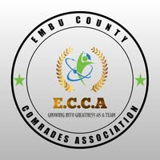

# Embu County Comrades Association (ECCA) Website

<div align="center">
  
  
  ### *"ECCA Ni Home"* - Growing Into Greatness As A Team
  
  A modern, Gen-Z-friendly website for the Embu County Comrades Association — a grassroots youth and community organization in Embu County, Kenya.
  
  [](https://reactjs.org/)
  [](https://www.typescriptlang.org/)
  [](https://tailwindcss.com/)
  [](https://vitejs.dev/)
</div>

---

## 📋 Table of Contents

- [About ECCA](#-about-ecca)
- [Features](#-features)
- [Tech Stack](#-tech-stack)
- [Getting Started](#-getting-started)
- [Project Structure](#-project-structure)
- [Pages Overview](#-pages-overview)
- [Design System](#-design-system)
- [Contributing](#-contributing)
- [License](#-license)

---

## 🏛 About ECCA

**Embu County Comrades Association (ECCA)** is a vibrant youth and community organization dedicated to:

- **Youth Empowerment** — Mentorship programs, career guidance, and skill development
- **Community Development** — Grassroots projects that transform Embu County
- **Environmental Conservation** — Tree planting campaigns and sustainability initiatives
- **Leadership & Networking** — Building tomorrow's leaders through real experience
- **Social Events & Comradeship** — Gala nights, sports events, and community gatherings

### Our Mission
To unite, inspire, and empower the youth of Embu County to actively participate in community development while fostering leadership, innovation, and comradeship.

### Our Vision
A thriving Embu County where youth are at the forefront of positive change, driving development and creating opportunities for all.

### Core Values
- 🤝 **Unity** — Stronger together as one community
- 🌍 **Inclusivity** — Every voice matters, every member counts
- 🎯 **Youth Leadership** — Young people leading change
- 💪 **Community Impact** — Actions that transform lives

---

## ✨ Features

### User Experience
- ✅ **Modern Gen-Z Aesthetic** — Bold, vibrant, and youth-friendly design
- ✅ **Mobile-First Responsive** — Optimized for all devices
- ✅ **Smooth Animations** — Engaging transitions and hover effects
- ✅ **Dark Mode Support** — Easy on the eyes, day or night
- ✅ **Fast Performance** — Optimized with Vite for instant loading

### Website Sections
- 🏠 **Home** — Hero section, impact stats, featured activities, upcoming events
- 📖 **About** — Organization history, mission, vision, and values
- 🎯 **Activities** — Detailed showcase of ECCA programs and initiatives
- 👥 **Leadership** — Team profiles and organizational structure
- 📅 **Events** — Upcoming and past events with details
- 🤝 **Join ECCA** — Membership registration form
- 📞 **Contact** — Get in touch with the organization

### Technical Features
- 🔍 **SEO Optimized** — Meta tags, semantic HTML, structured data
- ♿ **Accessible** — WCAG-compliant design patterns
- 🎨 **Design System** — Consistent theming with CSS variables
- 📱 **PWA Ready** — Can be installed as a mobile app
- 🚀 **Deployment Ready** — One-click deploy to Lovable

---

## 🛠 Tech Stack

| Technology | Purpose |
|------------|---------|
| **React 18** | UI component library |
| **TypeScript** | Type-safe JavaScript |
| **Vite** | Fast build tool and dev server |
| **Tailwind CSS** | Utility-first styling |
| **shadcn/ui** | Beautiful, accessible UI components |
| **React Router** | Client-side routing |
| **Lucide Icons** | Modern icon library |
| **React Query** | Data fetching and caching |

---

## 🚀 Getting Started

### Prerequisites

- Node.js 18+ installed
- npm or yarn package manager

### Installation

1. **Clone the repository**
   ```bash
   git clone <YOUR_GIT_URL>
   cd ecca-website
   ```

2. **Install dependencies**
   ```bash
   npm install
   ```

3. **Start development server**
   ```bash
   npm run dev
   ```

4. **Open in browser**
   ```
   http://localhost:5173
   ```

### Build for Production

```bash
npm run build
```

The built files will be in the `dist` directory, ready for deployment.

---

## 📁 Project Structure

```
ecca-website/
├── public/
│   ├── favicon.ico
│   └── robots.txt
├── src/
│   ├── assets/
│   │   └── ecca-logo.jpg        # Official ECCA logo
│   ├── components/
│   │   ├── layout/
│   │   │   ├── Navbar.tsx       # Navigation header
│   │   │   └── Footer.tsx       # Site footer
│   │   ├── shared/
│   │   │   ├── EventCard.tsx    # Event display card
│   │   │   ├── FeatureCard.tsx  # Feature/activity card
│   │   │   ├── LeaderCard.tsx   # Leadership profile card
│   │   │   ├── SectionHeading.tsx # Consistent headings
│   │   │   └── StatCard.tsx     # Statistics display
│   │   └── ui/                  # shadcn/ui components
│   ├── hooks/
│   │   ├── use-mobile.tsx       # Mobile detection
│   │   └── use-toast.ts         # Toast notifications
│   ├── lib/
│   │   └── utils.ts             # Utility functions
│   ├── pages/
│   │   ├── Index.tsx            # Home page
│   │   ├── About.tsx            # About ECCA
│   │   ├── Activities.tsx       # Programs & initiatives
│   │   ├── Leadership.tsx       # Team profiles
│   │   ├── Events.tsx           # Events calendar
│   │   ├── Join.tsx             # Membership form
│   │   ├── Contact.tsx          # Contact information
│   │   └── NotFound.tsx         # 404 page
│   ├── App.tsx                  # Main app component
│   ├── index.css                # Global styles & design tokens
│   └── main.tsx                 # App entry point
├── index.html                   # HTML template
├── tailwind.config.ts           # Tailwind configuration
├── vite.config.ts               # Vite configuration
└── package.json                 # Dependencies
```

---

## 📄 Pages Overview

### 🏠 Home Page (`/`)
The landing page featuring:
- Hero section with ECCA branding and CTA buttons
- Impact statistics (members, events, partners, tree planted)
- Feature cards highlighting key focus areas
- Upcoming events preview
- Call-to-action for joining

### 📖 About Page (`/about`)
Organization information including:
- ECCA's origin story and purpose
- Mission and vision statements
- Core values with detailed explanations
- Organizational milestones

### 🎯 Activities Page (`/activities`)
Comprehensive showcase of:
- Youth mentorship programs
- Environmental conservation projects
- Community engagement initiatives
- Networking and social events

### 👥 Leadership Page (`/leadership`)
Team profiles featuring:
- Executive committee members
- Role descriptions
- Leadership message
- Organizational structure

### 📅 Events Page (`/events`)
Event management showing:
- Upcoming events with dates and locations
- Past events gallery
- Event categories and filters

### 🤝 Join Page (`/join`)
Membership registration with:
- Benefits of joining ECCA
- Registration form
- Membership categories

### 📞 Contact Page (`/contact`)
Communication channels including:
- Contact form
- Physical address
- Social media links
- FAQ section

---

## 🎨 Design System

### Color Palette

| Token | Light Mode | Dark Mode | Usage |
|-------|------------|-----------|-------|
| `--primary` | Green (`142.1 76.2% 36.3%`) | Green | Brand color, CTAs |
| `--secondary` | Warm gray | Charcoal | Secondary elements |
| `--accent` | Orange (`24.6 95% 53.1%`) | Orange | Highlights, badges |
| `--background` | Off-white | Near-black | Page backgrounds |
| `--foreground` | Dark gray | Off-white | Text content |

### Typography

- **Display Font**: Space Grotesk — Bold headlines and titles
- **Body Font**: Inter — Clean, readable body text

### Components

All UI components are built using **shadcn/ui** with custom variants:
- `Button` — glow, primary, secondary, outline, ghost variants
- `Card` — elevated cards with hover effects
- `Input` — styled form inputs with focus states

---

## 🤝 Contributing

We welcome contributions from the ECCA community!

### How to Contribute

1. Fork the repository
2. Create a feature branch (`git checkout -b feature/amazing-feature`)
3. Commit your changes (`git commit -m 'Add amazing feature'`)
4. Push to the branch (`git push origin feature/amazing-feature`)
5. Open a Pull Request

### Code Style

- Use TypeScript for all new files
- Follow the existing component patterns
- Use semantic color tokens from the design system
- Write meaningful commit messages

---

## 📞 Contact

**Embu County Comrades Association (ECCA)**

- 📍 **Location**: Embu County, Kenya
- 📧 **Email**: info@ecca.co.ke
- 📱 **Phone**: +254 XXX XXX XXX

### Social Media
- Facebook: [ECCA Facebook](#)
- Twitter/X: [@ECCA_Kenya](#)
- Instagram: [@ecca_kenya](#)

---

## 📄 License

This project is proprietary software owned by Embu County Comrades Association (ECCA).

---

<div align="center">
  <strong>Built with ❤️ for the Embu County Comrades</strong>
  <br />
  <em>"Growing Into Greatness As A Team"</em>
</div>
